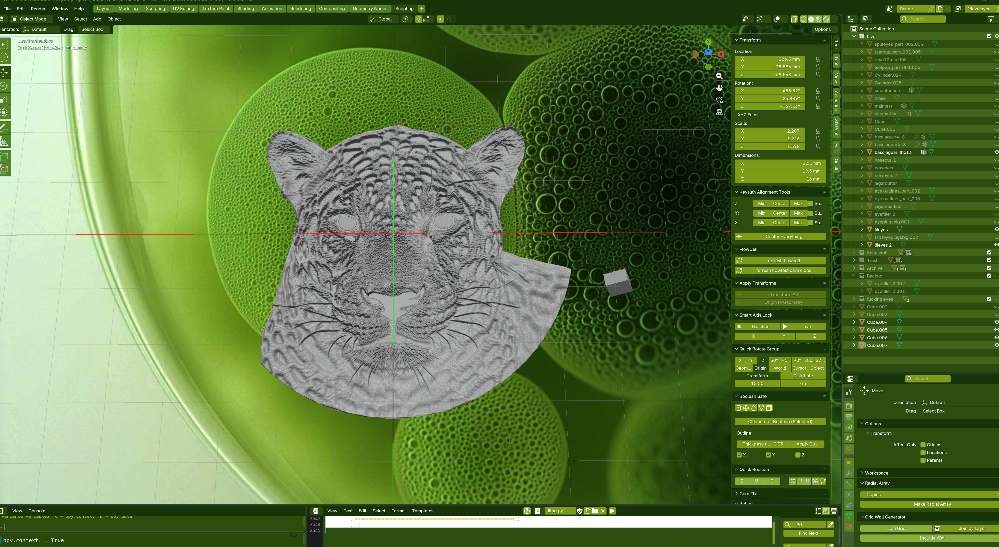

# Blender Structure

Blender setup writes a startup module with Blender's `register()` and
`unregister()` lifecycle hooks. It enables the FlowCell add-on once, cleans up
its bridge timer when disabled, and preserves the saved add-on preference.
After updating the setup helper, close Blender, choose Recheck setup in
FlowCell, then restart Blender to load the updated startup module. Recheck
preserves installed Button registrations and managed actions.

XYZ Dimensions reads the active selected object's dimension when X, Y, or Z is
pressed and shows the value in inches on that same Button. Before a reading, or
when no object is selected, the label shows `-- in`. Readings do not modify the
scene's units or geometry. Existing installations receive the readout wiring
through the normal catalog version synchronization after updating to XYZ 1.0.3;
the existing Button skins, placements, and IDs are preserved.

Lithophane 1.1.4 creates physical thickness independent of Blender's scene unit
scale. Its image picker offers Minimum thickness (mm) and Maximum thickness (mm),
defaulting to 0.1 and 17.0 mm. Dark pixels use the minimum; light pixels use the
maximum. Both values must be finite and positive, with maximum at least minimum;
equal values produce a uniform sheet. The alpha cutoff still removes transparent
areas before solidifying, and DPI/explicit image width and height still set X/Y.
The managed bridge accepts optional `min_thickness_mm` and `max_thickness_mm`
values; existing Illustrator requests that omit them use the same defaults.
