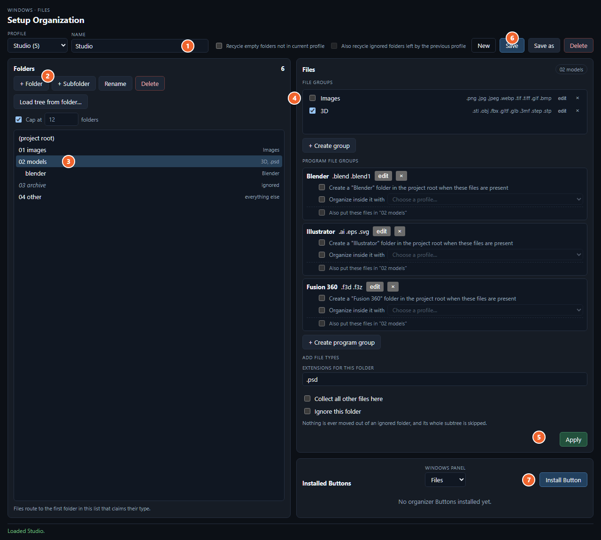

# File Organizer

Set up a folder layout once and turn it into a button. Then copy any folder,
click the button, and its files get sorted into that layout.

## Open it

In FlowCell, go to the **Windows** program, open the **Files** panel, and click
**Setup Organization**.

## Set it up

The numbers match the screenshot.

1. **Name**: type a name for the layout, like `Studio`. The button gets this name.
2. **+ Folder**: add a folder. To put a folder inside another one, select the
   parent and click **+ Subfolder**. To copy the folders from a folder you
   already have, click **Load tree from folder…** instead.
3. **Click a folder** in the list to select it.
4. **Tick the file types** that go in that folder (Images, 3D, …).
   - Need other types? Type them in **Extensions for this folder** (for example
     `.psd, .tga`), or click **+ Create group** to make a reusable set.
   - **Collect all other files here**: this folder gets every file that no
     other folder takes.
   - **Ignore this folder**: the organizer never touches anything in this folder.
5. **Apply**: saves your choices for that folder. Repeat steps 3–5 for each
   folder.
6. **Save**: saves the layout.
7. **Install Button**: choose a panel (default is **Files**) and click. A
   button with your layout's name shows up in that panel.

Each file type can go in only one folder. If two folders take the same type,
**Save** shows an error so you can fix it.

## Use it

1. In File Explorer, select the folder you want organized and press **Ctrl+C**.
   You can also copy the folder's path instead.
2. Click your new button.

Here's what the button does:

- It creates any folders from your layout that are missing.
- It moves each file into the folder for its file type.
- It never overwrites a file. If a file with the same name is already there,
  it skips that file.
- It leaves files alone when no folder takes their type, unless you set a
  **Collect all other files here** folder.
- It never touches ignored folders.

You can run it again whenever you like. Files that are already in the right
place stay where they are.

## Change it later

Pick the layout from the **Profile** dropdown, make your changes, and click
**Save**. The button uses the new layout the next time you click it.
